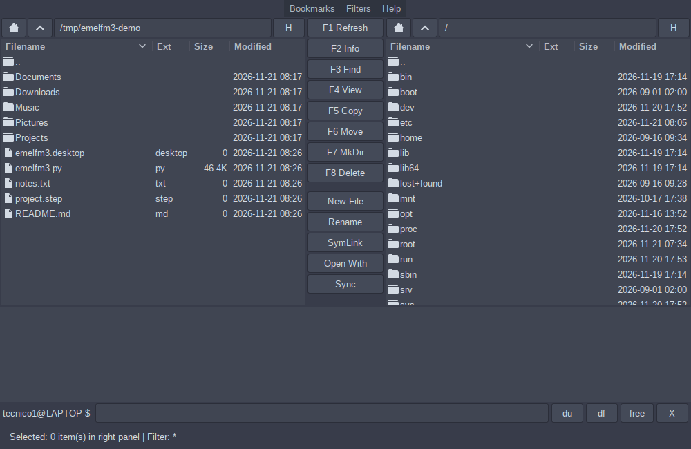
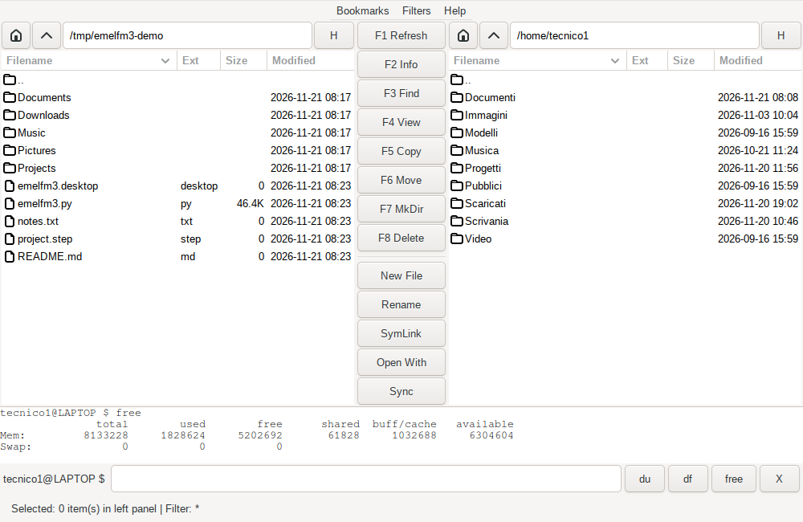

# emelFM3

**emelFM3** is a lightweight, single-file orthodox dual-pane file manager for Linux built with **Python 3** and **GTK 3**, inspired by the classic **emelFM** and **emelFM2**.

Designed for speed, low resource usage, and full keyboard-driven workflow, it integrates seamlessly with your native GTK desktop theme while providing an embedded command output pane and quick file operations.

---

## Screenshots

| Dark Theme | Light Theme |
| :---: | :---: |
|  |  |

---

## Features

- **Single-File Architecture:** Entire application contained in a single readable `emelfm3.py` script with zero external Python dependencies beyond PyGObject (`gi`).
- **Dual-Pane Navigation:** Independent left and right file panels with `Home` and `Parent folder` quick buttons, editable path bars, hidden files toggle (`H`), and sortable columns (`Filename`, `Ext`, `Size`, `Modified`).
- **Central Action Column:** Classic emelFM layout with instant access to `Refresh`, `Info`, `Find`, `View`, `Copy`, `Move`, `MkDir`, `Delete`, `New File`, `Rename`, `SymLink`, `Open With`, and `Sync`.
- **Built-in Command Output & Shell Bar:** Execute shell commands directly in the active directory with quick buttons (`du`, `df`, `free`) and external terminal launcher (`X`).
- **Bookmarks & File Filters:** Persistent JSON bookmarks (`~/.config/emelfm3/bookmarks.json`) and preset/custom glob filters (`*.png`, `*.step`, `*.tar*`, etc.).
- **Built-in Text Viewer & Recursive Search:** Lightweight file preview window (`F4`) and recursive file finder (`F3`).

---

## Requirements

- **Python 3** (`python`)
- **GTK 3** (`gtk3`)
- **PyGObject** (`python-gobject` / `python3-gi`)

### Installing Dependencies

- **Arch Linux:**
  ```bash
  sudo pacman -S python python-gobject gtk3
  ```
- **Debian / Ubuntu / Linux Mint:**
  ```bash
  sudo apt install python3 python3-gi gir1.2-gtk-3.0
  ```
- **Fedora:**
  ```bash
  sudo dnf install python3 python3-gobject gtk3
  ```

---

## Installation

### Option 1: Quick One-Liner Install (User Local)

```bash
mkdir -p ~/.local/bin ~/.local/share/applications && \
curl -fsSL https://githubusercontent.com -o ~/.local/bin/emelfm3 && \
chmod +x ~/.local/bin/emelfm3 && \
curl -fsSL https://githubusercontent.com -o ~/.local/share/applications/emelfm3.desktop && \
sed -i "s|Exec=emelfm3|Exec=\$HOME/.local/bin/emelfm3|g" ~/.local/share/applications/emelfm3.desktop
```

### Option 2: Manual Install via Git

```bash
git clone https://github.com
cd emelfm3
mkdir -p ~/.local/bin ~/.local/share/applications
install -Dm755 emelfm3.py ~/.local/bin/emelfm3
install -Dm644 emelfm3.desktop ~/.local/share/applications/emelfm3.desktop
```

*(Make sure `~/.local/bin` is included in your `PATH` environment variable).*

---

## Keyboard Shortcuts

| Shortcut | Action |
| :--- | :--- |
| `F1` / `Ctrl+L` | Refresh both panels |
| `F2` | Show detailed file/folder info |
| `F3` / `Ctrl+F` | Find files recursively |
| `F4` | View selected file in built-in viewer |
| `Shift+F4` | Create new file and open it |
| `F5` / `Ctrl+C` | Copy selected items to opposite panel |
| `F6` / `Ctrl+M` | Move selected items to opposite panel |
| `F7` / `Ctrl+D` | Create new directory (`MkDir`) |
| `F8` / `Delete` | Delete selected items |
| `Tab` / `Space` | Switch active panel |
| `Enter` / `Right` | Enter directory or open file |
| `BackSpace` / `Left` | Go to parent directory (`..`) |
| `Home` | Go to user Home directory (`~`) |
| `Insert` / `Ctrl+T` | Select current item and move cursor down |
| `Ctrl+R` | Rename selected item |
| `Ctrl+S` | Create symbolic link in opposite panel |
| `Ctrl+X` | Sync newer files to opposite panel |
| `Ctrl+H` | Toggle hidden files |
| `Ctrl+B` | Add current folder to bookmarks |
| `Ctrl+G` | Apply custom file filter |
| `Ctrl+W` | Show/Hide bottom terminal output pane |
| `Ctrl+Z` | Focus command entry bar |
| `Escape` | Return focus to active file list |
| `Ctrl+?` | Show keyboard shortcuts help |
| `Ctrl+Q` | Quit application |

---

## License & Disclaimer

**emelFM3** is free software released under the **GNU General Public License v3.0 (GPL-3.0)** — see the [LICENSE](LICENSE) file for details.

This program is distributed in the hope that it will be useful, **WITHOUT ANY WARRANTY**; without even the implied warranty of MERCHANTABILITY or FITNESS FOR A PARTICULAR PURPOSE. Always keep backups of important data before performing bulk file operations.
