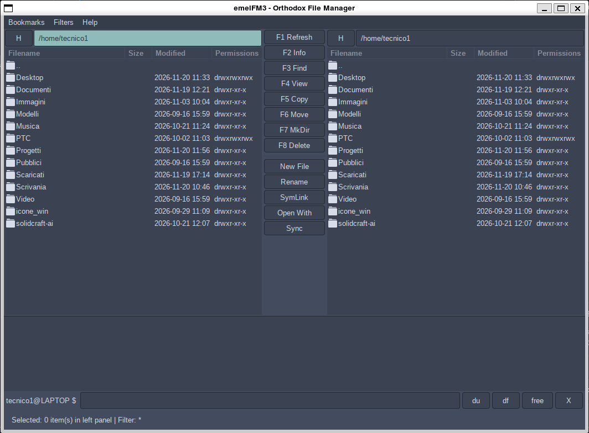

# emelFM3

A lightweight, single-file **orthodox dual-pane file manager** for Linux written in Python 3 and GTK 3 (PyGObject), inspired by the classic **emelFM** / **emelFM2**.

It uses your native GTK 3 system theme without custom CSS overrides, keeping a fast, distraction-free, retro workflow entirely controllable from the keyboard.



## Features

- **Classic Dual-Pane Layout:** Equal-width left and right file panes with a fixed central action toolbar (`F1`–`F8` + extra file tools).
- **Native GTK 3 Look:** Uses standard system symbolic icons (`folder-symbolic`, `text-x-generic-symbolic`) and your active GTK theme.
- **Built-in Command Output & Shell Bar:** Run shell commands directly inside the active pane's working directory (`user@host $`) with quick-action buttons (`du`, `df`, `free`) and an external terminal launcher (`X`).
- **Bookmarks & Filters:** Save favorite directories (`~/.config/emelfm3/bookmarks.json`) and filter files on the fly using wildcard patterns (`*.py`, `*.step`, etc.).
- **Directory Sync:** Copy only missing or newer files from the active pane to the destination pane.
- **Single-File Portability:** No complex build system or external Python libraries required beyond standard PyGObject.

## Requirements

- **Python 3**
- **GTK 3** and **PyGObject** (`gi`)

### Install Dependencies

**Arch Linux:**
```bash
sudo pacman -S python-gobject gtk3
```

**Debian / Ubuntu / Linux Mint:**
```bash
sudo apt install python3-gi python3-gi-cairo gir1.2-gtk-3.0
```

**Fedora:**
```bash
sudo dnf install python3-gobject gtk3
```

## Installation

1. Clone the repository:
   ```bash
   git clone https://github.com/legacy-craft/emelfm3.git
   cd emelfm3
   ```

2. Install the executable and desktop entry for your user:
   ```bash
   mkdir -p ~/.local/bin ~/.local/share/applications
   cp emelfm3.py ~/.local/bin/emelfm3
   chmod +x ~/.local/bin/emelfm3
   cp emelfm3.desktop ~/.local/share/applications/
   sed -i "s|Exec=emelfm3|Exec=\$HOME/.local/bin/emelfm3|g" ~/.local/share/applications/emelfm3.desktop
   update-desktop-database ~/.local/share/applications/
   ```

3. Run it from your application menu or terminal:
   ```bash
   emelfm3
   ```

## Keyboard Shortcuts

| Key | Action |
| :--- | :--- |
| `F1` / `Ctrl+L` | Refresh both panels |
| `F2` | File/Directory info dialog |
| `F3` / `Ctrl+F` | Recursive file search in active directory |
| `F4` | Built-in read-only file viewer |
| `Shift+F4` | Create new empty file |
| `F5` / `Ctrl+C` | Copy selected item(s) to opposite pane |
| `F6` / `Ctrl+M` | Move selected item(s) to opposite pane |
| `F7` / `Ctrl+D` | Create new directory |
| `F8` / `Delete` | Delete selected item(s) |
| `Enter` / `Right` | Open directory or launch file with default app |
| `BackSpace` / `Left` | Go to parent directory (`..`) |
| `Tab` / `Space` | Switch active panel (Left ↔ Right) |
| `Insert` / `Ctrl+T` | Tag/select current item and move cursor down |
| `Home` | Navigate to user's Home directory |
| `Ctrl+R` | Rename selected item |
| `Ctrl+S` | Create symbolic link in opposite pane |
| `Ctrl+X` | Sync active directory to opposite pane |
| `Ctrl+H` | Toggle hidden files (`H` button) |
| `Ctrl+B` | Bookmark current directory |
| `Ctrl+G` | Set custom filename filter |
| `Ctrl+W` | Show/hide bottom command output panel |
| `Ctrl+Z` | Focus bottom shell command input |
| `Ctrl+Q` | Quit emelFM3 |

## License

This project is open-source and released under the **GPL-3.0 License**.
